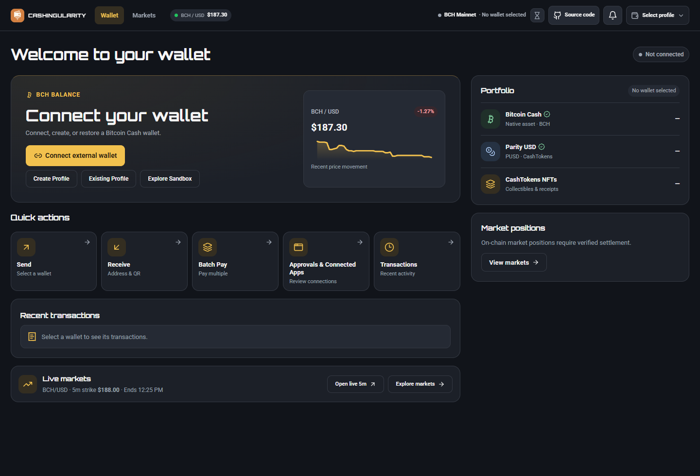
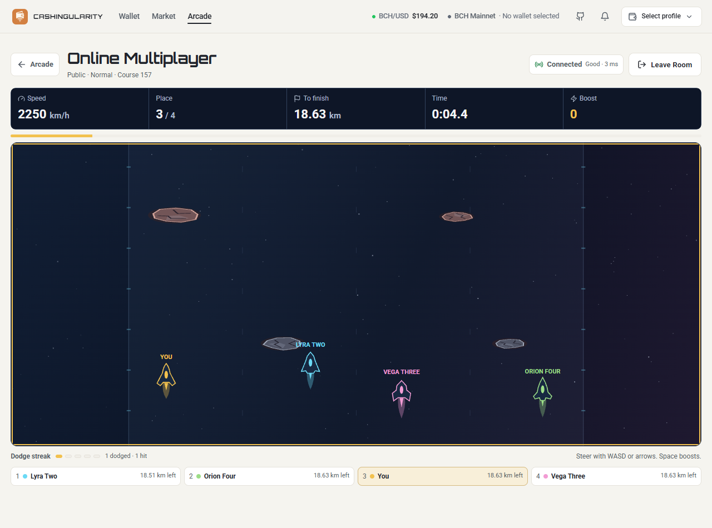

# Cashingularity

**Non-custodial Bitcoin Cash batch payouts**

**BCH BLAZE 2026** · Created by **Taylon McFly**

**[Live Demo](https://cashingularity.existencecode.com/)** · **[Mainnet Track presentation (PDF)](docs/blaze-submission/Cashingularity-Widget-Factory.pdf)** · [DoraHacks entry](https://dorahacks.io/buidl/51242) · [Deployment Guide](docs/DEPLOYMENT.md) · [On-chain Evidence](docs/ONCHAIN_PROOF.md)

Cashingularity helps teams pay contributors and bounty recipients in one Bitcoin Cash transaction. Open **Wallet → Batch Pay** to paste a list or import a spreadsheet, then review each recipient, amount, and miner fee before approving. **Wallet** also supports individual transfers. **Markets** offers BCH/USD charts and Paper Trading, and **Arcade** hosts Rocket Race.

- **BCH Chipnet (testnet).** [Confirmed two-recipient batch](https://explorer.selene.cash/tx/a87122c361114ab59e6547fad6f6921fd948700f51ed80dc365ddeb5a542ec3f?network=chipnet) paid 120,000 and 50,000 sats with a 500-sat miner fee.
- **BCH Mainnet (incoming).** [Confirmed 10,000-sat deposit](https://explorer.selene.cash/tx/72bced57c30dfe7659822b302e1fc5af7af2fbeec62b2f5ca93b96075d11dfcd?network=mainnet) to a test wallet. Outgoing Mainnet batch evidence remains pending.
- **EMBER2026 community voting (BCH Mainnet CashTokens).** `bitcoincash:zqx5xk9fpzgsrlk07t8e2asxx099d87txsgllfh3nd`



## Features

| Module | What this release includes |
| --- | --- |
| **Wallet** | Create or restore a local HD wallet; maintain separate signing and watch-only profiles; review BCH transfers and batch payments; display receive addresses, QR codes, and transaction history. |
| **BCH synchronization** | Electrum/Fulcrum-backed receive/change address discovery, UTXO reconciliation, mempool and confirmation tracking, reconnect recovery, and reorganization handling. |
| **WizardConnect** | QR pairing with compatible external wallets. Saved pairing data is encrypted in the browser; cached public addresses and xpubs do not independently authorize signing. A valid, approved wallet session is required. |
| **CashTokens** | Token-aware CashAddr support, fungible token and NFT balance discovery, BCMR metadata lookups, and token-safe ordinary BCH coin selection. |
| **Markets** | BCH/USD market charts, price rounds, resolved epochs, and positions. Paper Trading uses a virtual balance; CashScript settlement and refund experiments run separately on Chipnet. |
| **Rocket Race** | Seeded single-player races against computer opponents, and online races with 2–4 players through public matchmaking or private rooms. Multiplayer simulation and official rankings are server-authoritative. |

## What is live, experimental, or simulated?

- **BCH Mainnet — wallet:** The application supports reviewed BCH payment workflows and blockchain synchronization. Automated tests cover transaction safety and WizardConnect session boundaries. Final interoperability checks involving physical Selene and Paytaca signing remain pending; do not interpret automated tests as independent confirmation of every external wallet.
- **BCH Chipnet — contracts:** CashScript contract tests cover outcomes, payout conservation, oracle authorization, replay protection, and timeout refunds. Confirmed Chipnet settlement and refund transactions are documented in the [on-chain evidence](https://github.com/TaylonMcFly/Cashingularity/blob/main/docs/ONCHAIN_PROOF.md). XO Stack and SolidCash are isolated experimental contract tracks.
- **Paper Trading — simulation:** Market positions and balances are virtual. Public market deployment does **not** enable real-money prediction-market staking.
- **Arcade — gameplay:** Rocket Race does not require wallet signing, crypto deposits, or wagers. Anonymous player nicknames are game identities, not verified personal identities.

| BCH/USD market | Rocket Race multiplayer |
| --- | --- |
|  |  |

## Architecture

The browser client uses **React, TypeScript, and Vite**. **Fastify** serves the production frontend, HTTP APIs, wallet synchronization services, and the Arcade WebSocket backend. **Libauth** provides BCH primitives; market charts use **Lightweight Charts**; Rocket Race renders with **Canvas 2D**. Server-side state and multiplayer rankings are persisted on disk.

| Workspace | Responsibility |
| --- | --- |
| `packages/shared` | BCH amounts, shared types, pricing, deterministic race simulation, and protocol |
| `packages/frontend` | Wallet, Markets, Settings, and Arcade UI |
| `packages/backend` | HTTP/WebSocket APIs, Electrum synchronization, verification services, and authoritative races |
| `packages/contracts-cashscript` | CashScript contracts, transaction templates, and BCH VM tests |
| `packages/contracts-xo` | Isolated XO Stack templates and Chipnet utilities |
| `packages/contracts-solidcash` | Isolated SolidCash contracts and tests |

## Run locally

**Requirements:** Node.js **24 LTS** (package engines require Node.js 22 or newer) and npm. Commands run from the repository root.

```bash
git clone https://github.com/TaylonMcFly/Cashingularity.git
cd Cashingularity
npm ci
npm ci --prefix packages/contracts-xo --ignore-scripts
npm rebuild sqlite3 --prefix packages/contracts-xo
npm ci --prefix packages/contracts-solidcash
npm run build
npm start
```

After installation, open **http://localhost:3000/** to access the local application. For the hosted version, visit the **[Live Demo](https://cashingularity.existencecode.com/)**.

Configuration: [`.env.example`](https://github.com/TaylonMcFly/Cashingularity/blob/main/.env.example) · [Ubuntu / Oracle Cloud / Cloudflare deployment](https://github.com/TaylonMcFly/Cashingularity/blob/main/docs/DEPLOYMENT.md)

The isolated XO package may need its native SQLite dependency rebuilt; a live XO sidecar has additional dependencies and should use an independent Chipnet test wallet.

## Tests and reproducibility

```bash
npm run build
npm test
node scripts/rocket-race-smoke.cjs
node scripts/rocket-race-online-smoke.cjs
```

The reported release verification completed a clean build of all six workspaces and **253 passing automated tests**. Browser checks covered the wallet, market UI, Rocket Race single-player and multiplayer, touch input, reconnection, rematches, and persistent rankings. These local checks do not replace physical-device testing or independent verification of a public deployment.

More evidence: [Single-player Rocket Race](https://github.com/TaylonMcFly/Cashingularity/blob/main/docs/rocket-race/README.md) · [Online multiplayer and measurements](https://github.com/TaylonMcFly/Cashingularity/blob/main/docs/rocket-race-online/README.md) · [Chipnet/Mainnet evidence](https://github.com/TaylonMcFly/Cashingularity/blob/main/docs/ONCHAIN_PROOF.md)

## Security and limitations

- Signing keys for local profiles remain client-side. Watch-only profiles cannot sign. Saved external pairings are encrypted, and a cached address or xpub never substitutes for active signing authorization.
- The wallet checks the transaction being signed against the payment review. Users must still verify addresses, amounts, and fees before approving real transfers.
- Experimental contracts and sidecars are **not** represented as audited, production-ready financial services.
- Multiplayer currently operates on one backend instance. A restart removes active rooms but preserves rankings. Anonymous users can create multiple game identities.
- The [public deployment](https://cashingularity.existencecode.com/) is linked above; its live availability and physical Selene/Paytaca interoperability require independent verification and are not established by local smoke tests.
- Never use sample recovery phrases, test vectors, or published example addresses to safeguard real funds.

[Security boundaries](https://github.com/TaylonMcFly/Cashingularity/blob/main/docs/SECURITY_BOUNDARIES.md) · [Deployment and operations](https://github.com/TaylonMcFly/Cashingularity/blob/main/docs/DEPLOYMENT.md)

## License

Licensed under the [Apache License 2.0](https://github.com/TaylonMcFly/Cashingularity/blob/main/LICENSE). Copyright © 2026 Taylon McFly.
