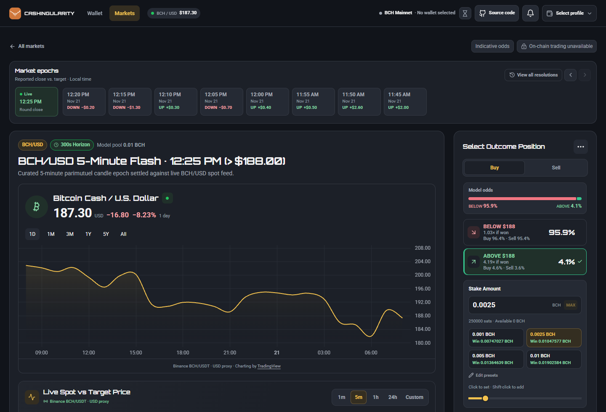

# Cashingularity
***Cashingularity** is an open-source Bitcoin Cash ecosystem combining a non-custodial BCH wallet, WizardConnect integration, CashTokens support, prediction markets, and an online multiplayer arcade. Built for BCH BLAZE 2026, it brings decentralized finance, smart contracts, and interactive experiences into one platform.*
**Bitcoin Cash wallet, prediction market lab, and racing arcade**

BCH BLAZE 2026 submission by **Taylon McFly**

Cashingularity is an open-source, non-custodial BCH web application. Its goal is to make everyday Bitcoin Cash transfers easier to inspect and give people a way to explore market mechanics and real-time applications without risking their funds.


## What you can use

| Area | Available in this release |
| --- | --- |
| **Wallet** | Create or restore a local HD wallet, manage separate profiles, watch a CashAddr without signing authority, review BCH sends and batch transfers, and view receive QR codes and transaction history. |
| **BCH synchronization** | Electrum/Fulcrum-backed receive and change address discovery, UTXO reconciliation, mempool and confirmation tracking, reconnect recovery, and checks for reorganizations. |
| **WizardConnect** | Pair with an external wallet by QR. Session credentials stay encrypted in the browser. A restored address or extended public key supports discovery only. Signing requires a live, authorized peer and explicit approval. |
| **CashTokens** | Token-aware CashAddr, fungible and NFT balances from wallet UTXOs, and BCMR metadata lookup. Ordinary BCH sends use token-free coin selection. |
| **Markets** | Explore BCH/USD rounds, live and historical price charts, resolved epochs, and market positions. Paper Trading uses virtual BCH and live price feeds when available. |
| **Rocket Race** | Play deterministic single-player races against AI or join a public or private online race with 2–4 human pilots. Online standings and rankings are server-authoritative. It uses a separate Arcade identity. |

## Networks and verification boundaries

- **Mainnet** supports reviewed BCH payments. Local signing keys stay in the browser. WizardConnect protocol, reconnection, and signing boundaries have automated coverage. Physical Selene and Paytaca signing remains pending operator verification.
- **Chipnet** is used for contract demonstrations. CashScript Mocknet tests cover both outcomes, payout conservation, oracle authorization, replay rejection, and timeout refunds. Documented Chipnet receipts show a confirmed UP settlement and a confirmed timeout refund. XO and SolidCash remain isolated contract tracks. [Chipnet evidence](docs/ONCHAIN_PROOF.md)
- **Paper Trading** uses a virtual balance and separate position history. Public market deployment disables contract preparation and real-money prediction staking. Arcade races have no wagers, token prizes, or wallet signing.

| BCH/USD market | Online Rocket Race |
| --- | --- |
|  |  |

## Architecture

React, TypeScript, and Vite power the browser app. Fastify serves the built frontend, HTTP APIs, wallet synchronization, and the Arcade WebSocket. Libauth handles BCH address and transaction primitives. Market charts are rendered locally with Lightweight Charts, and Rocket Race uses Canvas 2D. The backend keeps account and market state in a local WAL store and persists verified race rankings on disk.

| Package | Responsibility |
| --- | --- |
| `packages/shared` | BCH amounts and wire types, pricing utilities, deterministic race simulation and protocol |
| `packages/frontend` | Wallet, Markets, Settings, and Arcade |
| `packages/backend` | HTTP and WebSocket services, Electrum sync, isolated verification frame, and race authority |
| `packages/contracts-cashscript` | CashScript contracts, transaction templates, and BCH VM tests |
| `packages/contracts-xo` | Isolated XO Stack templates and Chipnet tooling |
| `packages/contracts-solidcash` | Isolated SolidCash contract and SolidHat tests |

## Run locally

Use **Node.js 24 LTS**. The package engine requires Node.js 22 or newer.

```sh
git clone https://github.com/TaylonMcFly/Cashingularity.git
cd Cashingularity
npm ci
npm ci --prefix packages/contracts-xo --ignore-scripts
npm rebuild sqlite3 --prefix packages/contracts-xo
npm ci --prefix packages/contracts-solidcash
npm run build
npm start
```

Open [Wallet](http://localhost:3000/), [Markets](http://localhost:3000/market), or [Arcade](http://localhost:3000/arcade). Local development needs no production secrets. The isolated XO install builds the SQLite binding needed by the test suite. A live XO sidecar needs its full native dependencies and a dedicated Chipnet wallet. See the [environment template](.env.example) and the [Ubuntu and Cloudflare deployment guide](docs/DEPLOYMENT.md).

## Verify the release

```sh
npm run build
npm test
node scripts/rocket-race-smoke.cjs
node scripts/rocket-race-online-smoke.cjs
```

The verified suite covers the six packages and includes 253 unit and integration tests. Browser runs verified Single Player, real two- and four-client online races, touch controls, reconnects, rematches, and ranking persistence. Physical mobile wallet compatibility and a public hosting smoke test are separate verification gates. Playwright and Chromium setup, measurements, and results are in the [Arcade documentation](docs/rocket-race-online/README.md).

## Security and operating limits

Local wallet backups and saved external pairings are encrypted. A watch-only profile carries no signing authority. The wallet checks signed transaction outputs against the user's review before broadcasting. Optional password and TOTP account protection uses Turnstile in an isolated verification origin. Never fund a public test vector or use one as a recovery phrase.

The experimental covenant and sidecar tracks have additional trust and settlement requirements. The online game currently runs on one backend instance. Restarts clear rooms and preserve rankings. Anonymous nicknames are public game identities.

[Security boundaries](docs/SECURITY_BOUNDARIES.md) · [Single Player](docs/rocket-race/README.md) · [Online Multiplayer](docs/rocket-race-online/README.md)

## License

Licensed under [Apache License 2.0](LICENSE). Copyright 2026 Taylon McFly.
